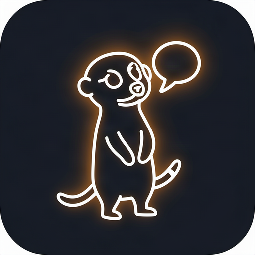

#  OpenMeerkat 🐾

> The open-source, self-hostable, agent-native omnichannel chatbot platform.


OpenMeerkat is an AGPL-3.0 alternative to ManyChat, Chatfuel, Wati, and
Respond — built from the ground up for self-hosters and for AI agents as
first-class operators. It is a fork of the OpenMeerkat community edition: the
commercially-licensed enterprise components have been removed and the whole
tree is distributed under AGPL-3.0 (see [THIRD_PARTY_NOTICES.md](THIRD_PARTY_NOTICES.md)).

The platform covers the full conversation lifecycle: a visual flow builder, a
shared inbox, AI agents, broadcasts, webhooks, public APIs, a CLI, and an MCP
server. A BullMQ-backed worker runs the background pipeline — chat, AI,
triggers, webhooks, analytics, and sequences — while the realtime server
pushes updates to the builder.

## Quickstart

Prerequisites: Node 24, pnpm 10, Docker.

```bash
# Start local infrastructure (PostgreSQL, Redis, object storage, MailHog)
docker compose up -d

# Configure the environment (see .env.example for the full schema)
cp .env.example .env

pnpm install
pnpm --filter @openmeerkat/database db:setup   # migrate + seed
pnpm dev                                        # builder on :3123, worker, realtime
```

Database migrations are applied explicitly — `db:migrate` is never run
automatically (see [CONTRIBUTING.md](CONTRIBUTING.md)). Never commit secrets:
`.env` is gitignored.

## Repository layout

| Path              | Role                                                                                                                    |
| ----------------- | ----------------------------------------------------------------------------------------------------------------------- |
| `apps/builder`    | **Next.js** web app (product UI): flows, inbox, AI agents, broadcasts. Default dev URL `http://localhost:3123`.          |
| `apps/worker`     | **BullMQ** background jobs: chat, AI, triggers, webhooks, analytics, sequences.                                         |
| `apps/realtime`   | Realtime server; builder exposes `NEXT_PUBLIC_REALTIME_URL` (e.g. `http://localhost:1999`).                             |
| `apps/cli`        | Command-line client.                                                                                                    |
| `apps/mcp-server` | MCP server exposing the public API surface to agents.                                                                   |
| `packages/*`      | Shared libraries: `database` (Drizzle + PostgreSQL), `ui`, `public-apis`, `sdk`, `worker-config`, `ai`, and more.       |
| `integrations/*`  | Channel and vendor integrations (WhatsApp, Messenger, Telegram, Zalo, TikTok, webchat, SMTP, OpenAI, Google Sheets, …). |

## Tech stack

- **TypeScript 5**, **React 19**, **Next.js 16** (builder)
- **Drizzle ORM** + **PostgreSQL** (with **pgvector**)
- **Redis** + **BullMQ** for queues
- **S3-compatible** storage (RustFS locally via Docker)
- Monorepo: **pnpm** workspaces + **Turborepo**
- Lint/format: **Ultracite** (Biome); tests: **Vitest**

## Local infrastructure

`docker compose up -d` provides PostgreSQL, Redis, object storage (RustFS),
MailHog, Adminer, and RedisInsight. Copy `.env.example` → `.env` (or per-app
env as documented) and adjust before first run.

## Use with AI agents

OpenMeerkat is built agent-native: every operation the UI exposes is also
reachable by automation. A first-class MCP server (`apps/mcp-server`) exposes
the public API surface — contacts, conversations, broadcasts, flows,
sequences — over stdio and SSE:

```json
{
  "mcpServers": {
    "openmeerkat": {
      "command": "node",
      "args": ["apps/mcp-server/dist/index.js"],
      "env": { "OPENMEERKAT_API_URL": "http://localhost:3123", "OPENMEERKAT_API_KEY": "..." }
    }
  }
}
```

(The `OPENMEERKAT_*` env var names are inherited from the upstream API until the
rename lands.)

The repository also ships agent-first documentation and tooling: `AGENTS.md`
(the canonical repo map), `.agents/skills/` (runbooks such as
`turborepo-workflow`, `drizzle-database`, `orpc-api`, `integration-channel`,
`worker-development`), `.agents/rules/` (always-on invariants), and
`.claude/agents/` (specialist subagents). AI contributors are expected to
follow these — see [CONTRIBUTING.md](CONTRIBUTING.md).

## Documentation

- [Docs](docs/)
- [Contributing](CONTRIBUTING.md)
- [Security policy](SECURITY.md)

## License

[AGPL-3.0](LICENSE). See [THIRD_PARTY_NOTICES.md](THIRD_PARTY_NOTICES.md) for
upstream provenance.
